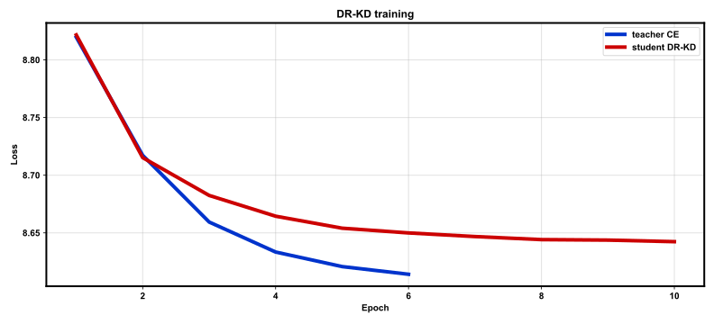
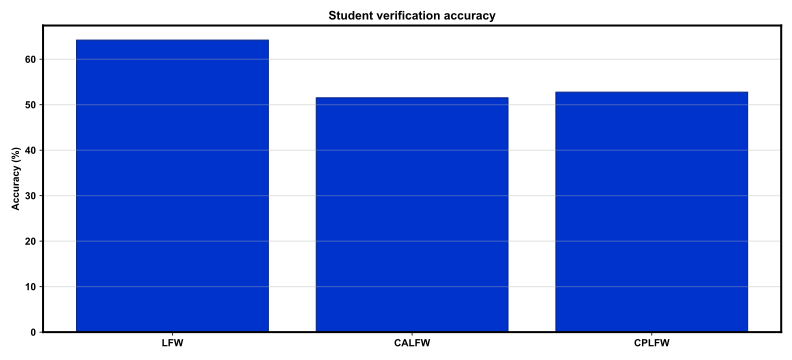

# REPORT: Doubly Relaxed KD (DR-KD) — full

**Protocol:** `full`  
**Teacher:** `resnet50` → **Student:** `resnet18`  

## Summary

| Benchmark | Accuracy | EER | Pairs |
|-----------|----------|-----|-------|
| LFW | 64.20% | 35.80% | 6000 |
| CALFW | 51.52% | 48.48% | 6000 |
| CPLFW | 52.75% | 47.25% | 6000 |

## Training

- Teacher epochs: 6
- Student epochs: 10
- Train images: 141610
- Identities: 7124
- Elapsed: 2665.16 s
- Checkpoint: `outputs/checkpoints/full/last.pt`

## Figures

### `train_loss.svg`



### `bench_acc.svg`



## Reproduce

```bash
bash scripts/smoke.sh
bash scripts/train_full.sh
```

## Notes

- DR-KD: Z-score logits + cosine alignment + student CE (see DEVIATIONS.md).
- Trained on CelebA; CASIA-WebFace / WebFace omitted.
